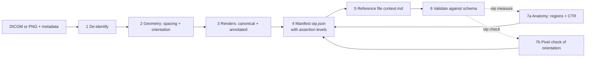

# The OIP story

A plain-language account of what we built, how it is layered, what an image goes through, and what went wrong on the way.
No code. Written for the owner to re-read before explaining the project to a clinician, a scientist or an engineer.
Every section ends with where to look for the detail. The last section is an append-only log that each working session
extends (see "How this file is kept" at the end).

Last full rewrite: 2026-11-12.

---

## 1. What OIP is, in one breath

A medical image on its own tells a vision-language model very little that is reliable: which side is the patient's left,
how many millimetres a pixel is, whether bright means dense or the opposite. The Open Image Protocol wraps the image in a
small folder, the *package*, that states those facts, says how each fact was obtained, and refuses to state what it does
not know. The model reads the package, not the bare image. OIP is about **understanding**, not diagnosis: it carries
observations and measurements, never interpretations (D-015, D-025).

- **For a clinician:** it is the technologist's note that travels with the image, written so that a machine cannot
  misread it: side, scale, polarity, what was measured by a tool, what was only guessed, what is unknown.
- **For a scientist:** it is a self-describing data format plus a benchmark that measures whether the description
  changes what models get right, and whether it makes them *check* the image or merely copy the text.
- **For an engineer:** a directory with a JSON manifest validated by a schema, a generated Markdown reference file,
  lossless pixels and canonical renders; a CLI and a stub MCP server expose the same verbs.

Detail: `docs/00-vision-and-scope.md`, `spec/oip-v0.1-draft.md` section 1.

---

## 2. The pipeline: from a medical image to an image with landmarks

Seven stages. Each is one module in `src/oip/`. The first six run inside `oip convert`; measurement and the pixel check
are separate verbs because they run a neural network and can be rerun later.

1. **De-identify** (`deid.py`). Names, IDs, birth dates and private tags are removed; UIDs are hashed; age becomes a
   five-year band. The package records how many tags were dropped.
2. **Geometry** (`geometry.py`). The two decisions everything else depends on. *Spacing:* which of several DICOM tags, if
   any, gives millimetres per pixel, in which plane (detector or patient), with what confidence. *Orientation:* which
   image edge is the patient's left, derived from the view and the header, and flagged as inferred when it is a guess.
   A plausibility rule compares the computed body width with the expected range and lowers confidence when they
   disagree.
3. **Renders** (`render.py`). The canonical render is an 8-bit image with one guarantee: dense tissue (or high counts)
   is bright, whatever the source stored. Nothing is rotated, flipped, cropped or resampled (D-005, D-006). The annotated
   render pastes the same pixels into a dark margin with edge labels (which side is L) and a scale bar, or the words
   "no calibrated scale". Nuclear-medicine packages also get the conventional inverted render.
4. **Manifest** (`convert.py`, `adapters.py`). Everything known is written to `oip.json`. Every fact that could be wrong
   carries an assertion level: `measured` (from the header), `computed` (by a deterministic tool), `inferred` (by a model
   or a rule), `external` (from a dataset file or report), or `unknown` (D-007). Quality flags name what is missing or
   suspicious. Non-DICOM inputs go through `convert_image.py`, where everything from a CSV is marked `external`.
5. **Reference file** (`context.py`). The manifest is turned into `context.md`, the text a model actually reads: what
   this is, how to read the renders, measured facts, computed measurements, inferred items, unknowns and cautions, and a
   self-check the model must pass before answering. External labels are *not* rendered by default (D-027). The template
   has a version; the paper runs used 0.2, current is 0.2.1.
6. **Validate** (`validate.py`). The manifest must pass the JSON Schema; the converter refuses to write a package that
   does not.
7. **Landmarks, two ways.**
   - **7a, anatomy** (`anatomy.py`, `measure.py`). A segmentation network (TorchXRayVision PSPNet) finds lungs, heart,
     aorta and other structures on frontal chest films. From the masks the tools compute the cardiothoracic ratio and, if
     spacing is calibrated, widths in millimetres. The model never computes a measurement; the tools never state a
     millimetre without a calibrated spacing (D-008, `CalibrationError`). Regions are `inferred`, measurements
     `computed`, and both stay `unvalidated` until a second source agrees (CheXmask cross-check since 2026-10-17).
     A second anatomy source, CXAS, runs in its own environment and gives rib-based thoracic widths.
   - **7b, pixel check** (`check.py`). `oip check` asks the pixels whether the stated orientation is plausible: on a
     frontal chest film the heart and aortic arch sit on the patient's left, so their centroid should fall on the side
     labelled L. It runs twice, once on the image and once mirrored, so the segmentation model's own left-right prior
     cancels out. The verdict is written into the manifest and into the reference file. This is the protocol's
     guarantee that the orientation was checked, because models mostly do not check (section 5).

After that, read-only verbs (`tools.py`) can re-window, crop or overlay regions; each produces a new render and a
transform record, and never touches the canonical pixels.

Detail: `spec/oip-v0.1-draft.md` sections 2, 5, 6, 7; any example in `spec/examples/` (read its `context.md` first).

---

## 3. The layers of the application

The word "layer" is used for two different things. Keep them apart when explaining.

### 3.1 Package layers (inside one `.oip` folder, spec section 3)

| Layer | What it holds | Who fills it |
|---|---|---|
| L0 | identity, provenance, de-identification, subject | converter |
| L1 | geometry, intensity semantics, acquisition, quality flags | converter |
| L2 | renders and lossless pixels | converter |
| L3 | semantic regions (masks, boxes, landmarks) | `oip measure` |
| L4 | measurements | `oip measure` |
| L5 | narrative reference file and external context | converter (`context.md`), dataset labels |

Profiles are named layer sets: `core` = L0–L2, `measured` = L0–L4, `full` = L0–L5. A package must not claim a layer it
did not fill. The benchmark's "layer ablation" means feeding a model a reference file cut at L2 versus the full one.

### 3.2 Application tiers (the repository)

| Tier | Where | Owns | Must never |
|---|---|---|---|
| Protocol | `spec/` (draft, JSON Schema, examples), `docs/01-reference-protocols/` (rules R1–R10), `docs/03-brainstorm/decisions-log.md` | what a package *is*; the change process (OEPs) | depend on one implementation |
| Reference implementation | `src/oip/` (converter, renders, context, anatomy, check, tools, CLI, MCP stub), `scripts/` (batch builders) | producing and reading packages | interpret an image; state mm without spacing |
| Evidence | `bench/` (task builder, runner, scorer, reports), `docs/reports/` | whether packages help models, and whether models check | let evaluation labels into a package (no-leakage rule) |
| Paper and governance | `docs/paper/`, `PLAN.md`, `CHANGELOG.md`, `CITATION.cff`, Zenodo and OSF records | the claims, the pre-registration, the releases | change code or packages under a running or pre-registered run |

The rules that hold the tiers together, in one line each: the model never computes (D-008); the tools never interpret
(D-025); no millimetre without a calibrated spacing; external text stays out of the reference file by default (D-027);
safety lives in the driver, not in the model (R4, `oip check`); the benchmark never sees labels (bench README); numbers in
the paper come only from the reference sheet.

Detail: `docs/README.md` (the documentation map), `docs/01-reference-protocols/comparison-and-lessons.md`.

---

## 4. How the benchmark works (because every colleague asks)

OIP-Bench shows the same image to a model under several conditions: the raw render alone, the render plus the reference
file, the annotated render plus the file, and variants with a wrong label injected either as a bare note or inside the
file. Tasks are of two kinds. *Understanding* tasks have truth in the manifest (which side is the left edge, is a scale
available, the cardiothoracic ratio, heart width) and gate releases. *Finding* tasks use dataset labels and are reported
only. Since round 3 the hard question is whether a model **compares the file with the pixels**: a four-cell design
crosses "file states the truth or a lie" with "image normal or mirrored", and only a model that looks passes all four.

Result in one sentence: every capable model answers the stated facts at 99–100 % with the full file (raw baselines
36–74 %), but only two of ten (Gemini, GPT) compare file and pixels; the rest follow one source. Hence `oip check`.

A confirmatory round was pre-registered on OSF on 2026-11-03 (osf.io/9rxbk) with code frozen at a tag; it started
2026-11-04.

Detail: `bench/README.md`, `docs/reports/round3a-2026-09-30.md`, `docs/paper/preregistration-draft-2026-11-02.md`.

---

## 5. Scars: what went wrong, by lesson

Ordered by what we learned, not by date. Each entry: what we saw, what it was, what we do now, where it is recorded.

### Lesson A: text inside an authoritative file is believed, so keep unverified text out of it

- **Wrong labels became more credible, not less.** A wrong finding placed in the file's External section, tagged
  "verify against the pixels", was adopted by gemma4 31B 100 % of the time versus 75 % as a bare note. A caution tag is
  not a safeguard. Now: external labels are not rendered by default; when requested they come after cautions with
  base-rate wording. OEP-001, D-027, 2026-09-08/09.
- **The benchmark leaked its own answers.** The first pilot packages carried radiologist boxes whose names contained the
  finding class ("Long axis of box F1 (Aortic enlargement)"); findings F1 jumped from 0.62 to 0.93. Now: benchmark
  packages are built with convert + measure only, and a keyword leak check runs after generation. Bench README,
  "No-leakage rule", 2026-09-08.

### Lesson B: models do not look at the image unless something forces them, so the tool must look

- **Cues and instructions did not make models check.** A cue-bearing template ("the cardiac apex should point toward
  the edge labelled L") plus a verify sentence lifted two of ten models by 12–16 points on the mirrored-image check,
  short of the 20-point gate, and cost four weaker models up to 59 points on the plain left-edge question because the
  cue confused image edge with patient side. OEP-003/004, not adopted, 2026-09-26 to 10-02.
- **Bigger, clearer renders did not help either.** A 1536-px inspection sheet with large side badges changed nothing;
  the models that partly pass use anatomy and the burned-in source marker, not our annotations. OEP-005 / D-030,
  2026-09-28.
- Consequence: the guarantee is tool-side (`oip check`, D-029: 94/100 decided, 0 wrong), the flip check was
  replaced by the four-cell conflict design, and burned-in markers are masked in the benchmark renders (D-032).

### Lesson C: a measurement is only as good as its definition and its truth

- **"CTR biased high" was raised, withdrawn, raised again and closed.** The lung-mask union seemed to underestimate
  thoracic width (Phase 2). CXAS rib margins agreed within 1 % (2026-09-09), so the caveat was withdrawn. CheXmask
  cross-check then showed thorax agreement (CCC 0.99) but hearts 4–5 % narrower (2026-10-17). Final: rib inner margin is
  1.5–3.4 % narrower than lung union, package CTR separates the cardiomegaly label with AUC 0.95, the lung-union
  definition stands and the 22 % label prevalence explains the share above 0.5. D-034.
- **A truth derived from the file measures compliance, not accuracy.** NIH heart width in millimetres used the same
  nominal spacing the file states, so that endpoint only shows whether the model used the stated scale. Guards of that
  kind need calibrated or second-source truth. 2026-09-29.
- **Models computing from self-estimated pixel coordinates got worse with more information.** Two of eleven models
  dropped on quantitative questions when given geometry without computed measurements. Now: the file says "judge it
  from the picture as a ratio; do not compute from your own pixel estimates" (template 0.2.1, D-031), and `oip
  describe` warns when a `core` package is used for quantitative questions.

### Lesson D: at scale, the harness fails in ways that look like model behaviour

- **Reasoning ate the answer.** glm-5.3-flash reasons inside the content field even with thinking off; an 800-token
  cap truncated up to 57 of 82 replies in a paper cell and they were scored as wrong. Now: `done_reason` is recorded per
  row, a cut-off reply counts as no answer, the cap is 8,000 for such models, and the limitation is in the paper
  (amendment 12). 2026-09-29, 10-05.
- **A retired model tag returned HTTP 410 on every call; rate limits returned 429 for hours.** Now: a model aborts after
  five identical errors, a 429 "usage limit" aborts at once, and transient cloud errors get 20 tries. 2026-09-08, 09-11,
  10-07.
- **Two cloud lanes starved each other.** Parallel Ollama cloud runs hit the daily allowance faster and aborted into
  each other's back-off, even across Claude sessions. Now: one cloud model at a time, enforced by a file lock. 2026-09-28.
- **The template changed under a running multi-day ablation.** The working clone moved to template 0.2.1 while the
  Claude arm of an ablation was paused; resuming from HEAD would have changed the prompts mid-experiment. Now: resume
  from the harness commit that produced the control arm, in a detached worktree; every row carries the harness commit,
  prompt hash and scorer version. 2026-10-02.
- **A "latest run wins" report rule overwrote a control arm.** Another session reused the control condition name on a
  smaller run. Now: ablation controls get their own condition names and the report selects four-arm runs explicitly.
  2026-09-28.
- **An Ollama update changed a default.** gemma4 e4b started thinking by default; the harness now sends thinking off
  explicitly and records the daemon version and environment in every run. 2026-10-07.

### Lesson E: the machine lies quietly; record the environment and keep work off synced folders

- **A workaround that did nothing was carried for five weeks.** The Metal flag set on 2026-09-08 for garbled local
  output made no difference under a later Ollama; a controlled comparison dropped it. Now: never re-set it; every run
  records the daemon's environment. D-033, 2026-10-16.
- **iCloud evicted the repository.** With low disk, files under `~/Desktop/OIP` were evicted and reads blocked, even
  importing torch. Now: work only in `~/oip-work` with `~/oip-venv`; the Desktop clone is stale. 2026-09-08.
- **Small macOS traps:** `.pth` files in a venv got the hidden flag (editable install broken, 2026-09-06); launching
  Ollama with `open -a` from a shell hands it the shell's environment (launch from Spotlight); lane scripts kept in
  `/tmp` were lost in a reboot (keep set-aside run dirs under `bench/results/_aside/`, 2026-10-08).

Detail: `docs/03-brainstorm/decisions-log.md` for every D and OEP; `bench/README.md` for the harness lessons;
`CHANGELOG.md` for what shipped.

---

## 6. Where the work stands (2026-11-12)

- Protocol 0.1 draft, implementation 0.2.1, released on GitHub and Zenodo (software DOI 10.5281/zenodo.23490342,
  concept DOI 10.5281/zenodo.23052074, data bundle DOI 10.5281/zenodo.23040047).
- Paper: revised manuscript produced in the separate Research Automation study; handover to the Lancet track on
  2026-11-02; co-author review actions from 2026-10-23 in `docs/paper/`.
- Confirmatory round pre-registered on OSF (osf.io/9rxbk, 2026-11-03), code frozen at tag `prereg-confirm-2026-11`,
  runs started 2026-11-04: three API lanes with three repeats, Ollama cloud chain one model at a time, local chain.
  Analysis and addendum due 2026-11-23.
- Open on the owner: Ibrahim's OSF approval and the registration DOI, PROTOKOLL.md 1.0, expert readers.

Detail: `PLAN.md` section 0 and the run log; the project memory in the Claude session.

---

## 7. Story deltas (append-only)

One entry per working session that changed behaviour, moved a responsibility between tiers, or added a scar.
Three sentences: what changed, why, which section above it touches. Newest at the bottom.

- 2026-11-12 — File created from the repository, the decisions log, the bench README and the session memory.
  Sections 2 and 3 describe the code as of commit 2fc68bf. No behaviour changed.

---

## How this file is kept

- **Audience and altitude.** This file is read by a person, aloud, to colleagues. Plain words, no code, no tables of
  numbers beyond what a sentence needs. Detail lives in the files each section points to.
- **Session rule** (in the project `CLAUDE.md`): a session that changes what the pipeline does, moves a responsibility
  between tiers, or hits a new pitfall appends a story delta to section 7 before it ends. When a delta makes a section
  above wrong, that section is corrected in the same session; a scar gets its own bullet under the lesson it belongs
  to, or a new lesson if none fits.
- **Story map.** `python scripts/story_map.py` (optionally `--days 30 --open`) writes `docs/story-map.html`: the
  pipeline stages and tiers above, each shaded by how many commits touched its files in the window, the latest commit
  under each, uncommitted files flagged, the delta timeline, scars per lesson, and a warning when pipeline or protocol
  commits are newer than the last delta. Open it before explaining the project to see which part of the story moved.
  The page is generated and not committed.
- **Teach-back.** A few times a week the owner explains one section to Claude in their own words without reading it;
  Claude compares the explanation with the code and the file and names what drifted. Misses are fixed in the file, not
  only in the owner's head.
